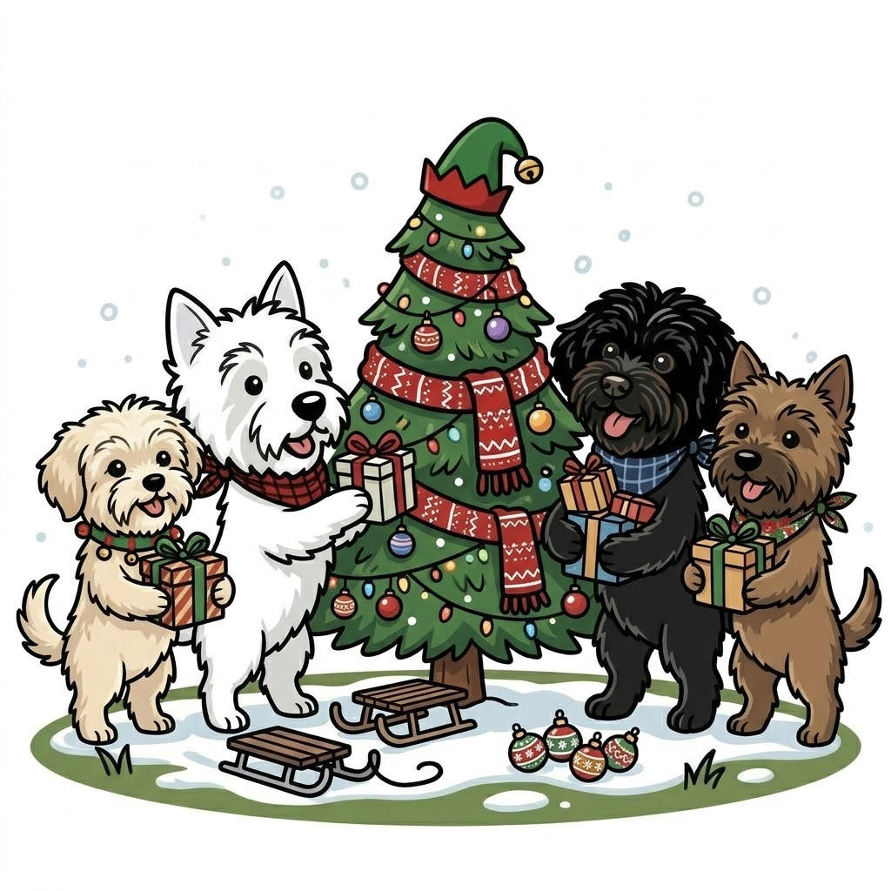

<h1 align="center">Secret Santa Paws</h1>

<b>A free, private Secret Santa matcher for dog gift exchanges.</b> 
Load your spreadsheet, make the matches, and email everyone their giftee's details, all in your web browser.

  <a href="https://spr1ngw1ll0wtr33.github.io/SecretSantaPaws/"><b>Open the app</b></a> ·
  <a href="https://spr1ngw1ll0wtr33.github.io/SecretSantaPaws/video/Secret-Santa-Paws-how-it-works.mp4"><b>Watch the 6-minute explainer video</b></a> ·
  <a href="Secret-Santa-Paws-template.xlsx"><b>Download the template spreadsheet</b></a>

---

## What it does

Secret Santa Paws was made for a group of dog owners who run a Secret Santa on Instagram, with gifts posted between the UK, Europe, North America, Australia and beyond. It:

- **reads a spreadsheet** of participants, and checks it for mistakes before anything else happens
- **makes the matches**, following each person's rule about which countries they're willing to post to
- **keeps a master list** of who sends to whom, so a lost email can always be sent again
- **writes a personal email for each entry**: "Dear Bertie, your match is…", with the giftee's Instagram account, dog's name and postal address
- **helps you send them one by one** through Gmail or your email app, ticking each one off as you go

**Nothing is uploaded.** The spreadsheet is read on your own computer, and the app has no server, no accounts and no tracking.

## How a draw works

1. **Load** the participants spreadsheet. A green box means it's been read correctly; a red box names any row that needs fixing.
2. **Make** the matches. Four green ticks mean every match has been checked.
3. **Download** the master list. It's your back-up, so do this before sending anything.
4. **Check** the email wording. Fill in the spending limits (TBA), the opening day date and your hashtag.
5. **Send** each email and tick it off. "Save progress" every so often downloads an up-to-date master list, and "Reload a saved master list" in step 1 lets you carry on later.

The [explainer video](https://spr1ngw1ll0wtr33.github.io/SecretSantaPaws/video/Secret-Santa-Paws-how-it-works.mp4) walks through all five steps.

## The spreadsheet

Start from the [template](Secret-Santa-Paws-template.xlsx). Its second and third tabs explain everything, with examples. The first tab needs these six headings:

| IG Account | Dog's Name | Address | Country of Residence | Will Send To | Email Address |
|---|---|---|---|---|---|

- **One row per entry.** An account entering two dogs separately has two rows, with the same IG Account on both. Several dogs sharing one entry can go in one cell, e.g. "Bella & Max".
- **Country of Residence** must be a country the app knows. The template has a drop-down list.
- **Will Send To** controls only who someone *sends* to:
  - **Any**: happy to send anywhere
  - **a country**, e.g. United Kingdom
  - **EU**: the 27 EU countries
  - **Europe**: the EU countries plus Iceland
  - **a list** such as **UK & Europe** or **Canada & USA**. Separate countries with `&` or a comma.
- **All rows for one account** must have the same Country of Residence and Will Send To.
- **Only the first tab is read.** If your list lives in Google Sheets, put it on the first tab (or copy it to a new spreadsheet), then use File → Download → Microsoft Excel (.xlsx).

**Countries the app knows:** United Kingdom, United States of America, Canada, Australia, Iceland, Japan, Germany, Netherlands, France, Italy, Croatia, Sweden, Thailand and Poland. Common short forms such as UK, USA and The Netherlands work too.

## The matching rules

In order of priority:

1. **Never broken:**
   - every entry sends one gift and receives one
   - nobody sends to their own account (not even to another of their own dogs)
   - everyone's Will Send To is followed
2. **Avoided unless there's no other way:** one account sending to the same account twice.
3. **Then avoided unless there's no other way:** two accounts being each other's Secret Santa.

If the choices make a complete match impossible (for example, someone who will only send to Japan when nobody else lives there), the app says exactly who is affected and why, so you can sort it out with the people concerned.

## Sending tips

- **On a computer, use the Gmail button.** It opens Gmail in a browser tab with the email filled in. You need to be logged in.
- **On a phone or tablet, use the Email app button.** It opens your email app, e.g. the Gmail app. The Gmail button doesn't work on phones.
- **Skim every email before pressing Send.**
- **Tell the group in advance** which address the emails will come from and what the subject line will be, and ask them to check their spam folders.

## Privacy

- The spreadsheet never leaves your device. The app's progress is saved only in your own browser.
- **Never put a real participants list on GitHub** or anywhere public.
- After the gifts have arrived, delete the master lists from your Downloads folder, and press "Clear everything saved on this device" at the bottom of the app.

## Trying it out

[`test-dummy.xlsx`](test-dummy.xlsx) has 78 made-up entries (addresses ending in @example.com), with a few awkward cases built in. [`HOW-TO-TRY-IT.txt`](HOW-TO-TRY-IT.txt) is a step-by-step practice run.

## Using it for your own group

You're very welcome to use it as it is, or to copy and change it.

1. **To use it as it is,** open [the app](https://spr1ngw1ll0wtr33.github.io/SecretSantaPaws/) and follow the five steps. Edit the email wording in step 4; the app remembers your edits on that computer.
2. **To make your own copy,** click **Fork** at the top of this page. Then, in your copy, go to **Settings → Pages → Deploy from a branch → main → / (root) → Save**. Your copy will appear at `https://<your-username>.github.io/SecretSantaPaws/`.
3. **To add a country,** add one line to the `COUNTRIES` list at the top of [`matching.js`](matching.js), e.g. `{ name: 'Spain', also: ['España'] },`. Then run `python3 tools/make-template.py` to refresh the template's drop-down list.
4. **To change the default email wording,** edit `DEFAULT_SUBJECT` and `DEFAULT_TEMPLATE` in [`index.html`](index.html).

Technical details, including how the matching works and how it was tested, are in [`DESIGN-NOTES.md`](DESIGN-NOTES.md).

## What's in this repository

| File | What it is |
|---|---|
| `index.html` | The app |
| `matching.js` | Countries, spreadsheet checks and matching |
| `xlsx.full.min.js` | SheetJS, which reads and writes spreadsheets |
| `header.jpg` | The illustration |
| `Secret-Santa-Paws-template.xlsx` | Blank spreadsheet to start from |
| `test-dummy.xlsx`, `HOW-TO-TRY-IT.txt` | Made-up test data and a practice run |
| `video/` | The explainer video, and the scripts that made it |
| `tools/make-template.py` | Rebuilds the template from the app's country list |
| `DESIGN-NOTES.md` | Technical notes |
| `LICENSE`, `THIRD-PARTY-NOTICES.md`, `licenses/` | Licences |

## Licence and credits

- **Secret Santa Paws** is free to use, copy and change, under the [MIT licence](LICENSE). It is provided as is, with no warranty.
- **Spreadsheet reading and writing:** [SheetJS](https://sheetjs.com) Community Edition, under the Apache License 2.0 (see [`THIRD-PARTY-NOTICES.md`](THIRD-PARTY-NOTICES.md)).
- **Fonts:** Nunito and Mountains of Christmas, from Google Fonts (SIL Open Font Licence).
- **Illustration:** created with Google Gemini, and included for use with this app.

Happy gifting! 🐾
